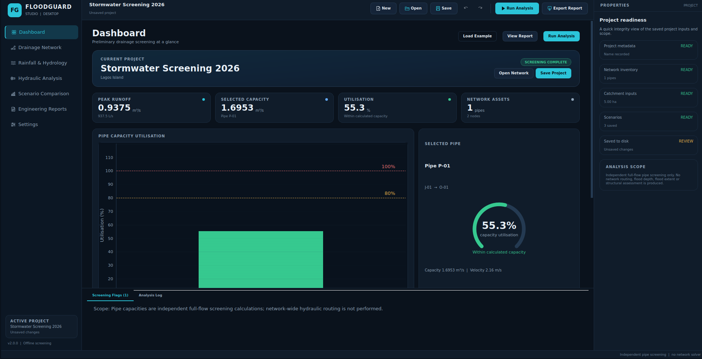
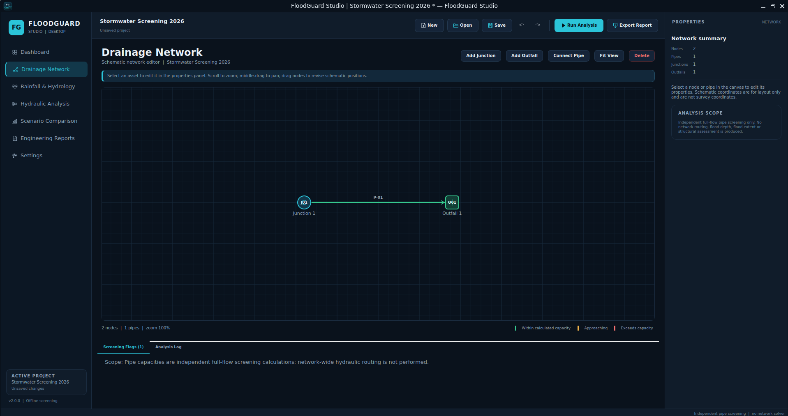
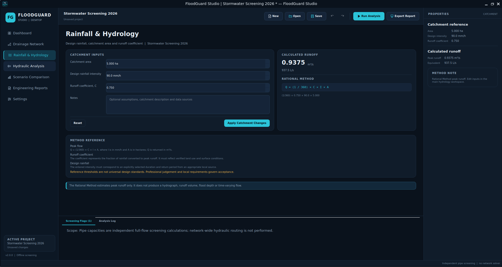
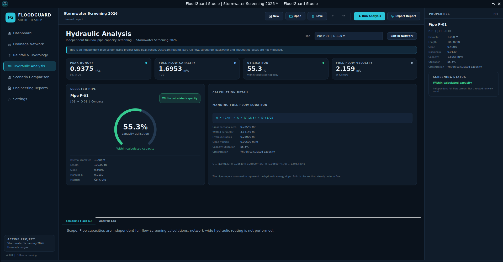
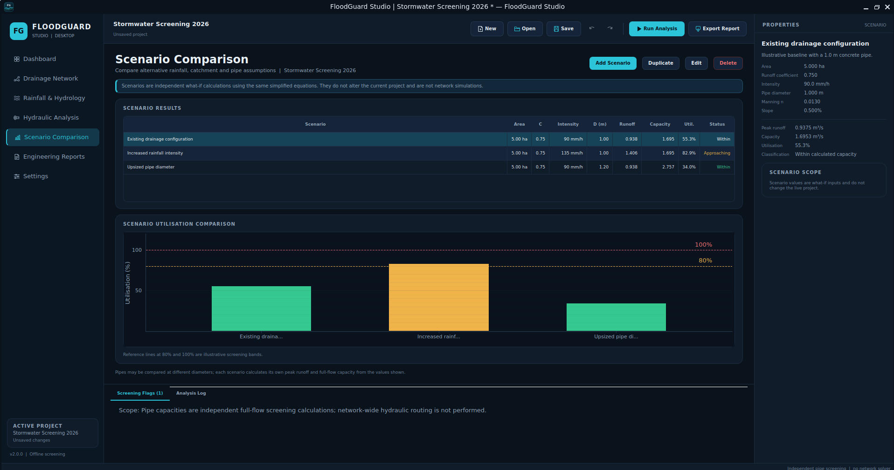
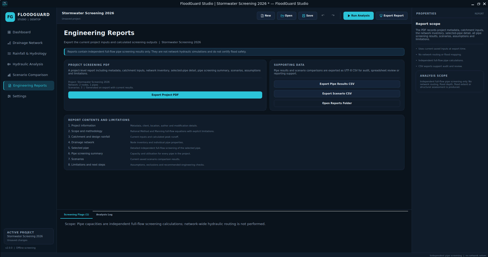

# FloodGuard Studio

**Offline desktop screening for urban stormwater runoff and circular pipe capacity.**

FloodGuard Studio is a native Python/PySide6 engineering application for preliminary
stormwater screening. It combines the Rational Method, Manning's full-flow equation,
capacity-utilisation flags, an editable drainage schematic, scenario comparison and
reproducible PDF/CSV reporting in a single local desktop workspace.

> **Engineering scope:** FloodGuard Studio performs preliminary screening only. It is
> not a network hydraulic model, does not route flows or calculate flood depth/extent,
> and is not certified design software. See [Engineering methods and limitations](#engineering-methods-and-limitations).



## What it does

- Calculates Rational Method peak runoff from catchment area, design rainfall intensity
  and runoff coefficient.
- Calculates independent full-flow capacity for circular pipes using Manning's equation.
- Compares project peak runoff with each pipe's calculated full-flow capacity.
- Provides an interactive junction/outfall/pipe schematic with editable properties.
- Compares saved what-if scenarios for rainfall, catchment and pipe assumptions.
- Exports project screening PDF reports and UTF-8 CSV result tables.
- Stores versioned `.fgsproj` project files locally with atomic saves and schema checks.
- Runs fully offline with no server, browser, telemetry, account or cloud dependency.

Reference case: `A = 5 ha`, `I = 90 mm/h`, `C = 0.75` gives peak runoff
`0.9375 m³/s`. A `1.0 m` concrete pipe with `n = 0.013` and `0.5%` slope has an
independent full-flow capacity of about `1.6953 m³/s`, or `55.3%` utilisation.

## Scope boundaries

FloodGuard Studio deliberately does **not** provide:

- network flow routing, continuity or a time-varying hydrograph;
- part-full depth, surcharge, backwater or inlet/outlet control;
- flood depth, flood extent, damage or safety predictions;
- design-standard compliance certification;
- SWMM integration or any hidden external hydraulic solver.

The 80% and 100% utilisation thresholds are illustrative screening bands, not universal
design criteria. A below-100% result does not establish flood-free operation.

## Screenshots

| Dashboard | Drainage network |
|---|---|
|  |  |

| Rainfall and hydrology | Hydraulic analysis |
|---|---|
|  |  |

| Scenario comparison | Engineering reports |
|---|---|
|  |  |

## Requirements

- Python 3.11 or newer
- PySide6 6.12, pyqtgraph, NumPy, Pandas and ReportLab
- A desktop session on Windows, Linux or macOS

Pinned runtime dependencies are in `requirements.txt`; development and packaging tools
are in `requirements-dev.txt`.

## Run locally

### Windows PowerShell

```powershell
py -3.11 -m venv .venv
.\.venv\Scripts\Activate.ps1
python -m pip install --upgrade pip
python -m pip install -r requirements-dev.txt
python app.py
```

### Linux or macOS

```bash
python3.11 -m venv .venv
source .venv/bin/activate
python -m pip install --upgrade pip
python -m pip install -r requirements-dev.txt
python app.py
```

The application has no internal web server. Close the window to exit.

### Windows desktop shortcut (WSL)

When running from a WSL checkout, install a desktop launcher from PowerShell:

```powershell
powershell -ExecutionPolicy Bypass -File packaging\create_wsl_shortcut.ps1 `
    -Distro Ubuntu -ProjectDir /home/<user>/floodguard-lite
```

It writes a hidden-console VBS launcher to `%LOCALAPPDATA%\FloodGuardStudio` and a
**FloodGuard Studio** shortcut on the Windows desktop. Keep the shortcut's window style
set to Normal: launching the app minimized can leave the WSLg window blank.

## Typical workflow

1. Start with the built-in junction-to-outfall project, or use **Load Example** on the
   dashboard.
2. Edit catchment inputs on **Rainfall & Hydrology** and apply the changes.
3. Add junctions/outfalls, connect pipes and edit pipe properties on **Drainage Network**.
4. Review independent capacity utilisation on **Hydraulic Analysis**.
5. Compare saved what-if cases on **Scenario Comparison**.
6. Export the current project report or result CSVs from **Engineering Reports**.
7. Save the project as a `.fgsproj` file. Unsaved changes are marked in the title bar.

| Action | Shortcut |
|---|---|
| New project | `Ctrl+N` |
| Open project | `Ctrl+O` |
| Save project | `Ctrl+S` |
| Save project as | `Ctrl+Shift+S` |
| Run analysis | `F5` |
| Export report | `Ctrl+E` |
| Undo / redo | `Ctrl+Z` / `Ctrl+Y` or `Ctrl+Shift+Z` |

## Project files and local data

- Project files use the `.fgsproj` extension and JSON schema version `1`.
- Saves are atomic: a temporary file is written before replacing the previous project.
- The schema records project metadata, catchment inputs, nodes, pipes and scenarios.
- Loaded values pass structural and engineering validation before use.
- Application preferences are stored under `%APPDATA%\FloodGuardStudio\settings.json`
  on Windows or `~/.config/FloodGuardStudio/settings.json` on Linux.
- Window geometry is stored separately through Qt `QSettings`.
- Reports and projects default to the user's Documents folder and can be changed in
  **Settings**.

A bundled example is available at
[`data/example_project.json`](data/example_project.json). The application's **Load
Example** action generates the same project directly from
`create_example_project()`.

## Engineering methods and limitations

### Rational Method

```text
Q = (1/360) × C × I × A
```

- `Q` = estimated peak runoff (m³/s)
- `C` = runoff coefficient (0 to 1)
- `I` = rainfall intensity (mm/h)
- `A` = catchment area (ha)

The user must justify the intensity for a specific duration, return period and local
IDF source. The method estimates peak flow only; it does not generate a hydrograph or
runoff volume.

### Manning full-flow capacity

```text
Q = (1/n) × A × R^(2/3) × S^(1/2)
```

For a circular pipe flowing full:

```text
A = πD²/4
P = πD
R = A/P = D/4
S = slope_percent / 100
```

The pipe slope is assumed to equal the hydraulic energy slope. The calculation assumes
steady, uniform, full-pipe flow and does not include inlet/outlet losses, part-full
flow, surcharge, backwater, blockage or sediment.

### Capacity utilisation

```text
Utilisation (%) = (peak runoff / full-flow capacity) × 100
```

| Utilisation | Screening classification |
|---|---|
| `< 80%` | Within calculated capacity |
| `80%` to `100%` inclusive | Approaching calculated capacity |
| `> 100%` | Calculated demand exceeds capacity |

The methods, assumptions, worked reference calculations and required real-world data
are documented in [ENGINEERING_METHODS.md](ENGINEERING_METHODS.md).

## Technology

| Layer | Technology |
|---|---|
| Language | Python 3.11+ |
| Desktop UI | PySide6 / Qt Widgets |
| Network canvas | QGraphicsView / QGraphicsScene |
| Charts | pyqtgraph |
| Engineering data | Python dataclasses, NumPy, Pandas |
| Reports | ReportLab |
| Persistence | Versioned JSON (`.fgsproj`), local settings JSON |
| Testing | pytest, pytest-qt, offscreen Qt |
| Linting | Ruff |
| Windows packaging | PyInstaller |

No Streamlit, Flask/FastAPI application server, Electron, browser wrapper, localhost
service, paid API or cloud service is used by the desktop application. The previous
Streamlit prototype is retained only in the gitignored `.legacy_streamlit/` archive.

## Repository structure

```text
floodguard-lite/
├── app.py                         # Desktop entry point
├── floodguard/
│   ├── project.py                 # Versioned project model and persistence
│   ├── analysis.py                # Project-level screening assembly
│   ├── runoff.py                  # Rational Method
│   ├── hydraulics.py              # Manning/full-flow capacity
│   ├── scenarios.py               # Scenario definitions and evaluation
│   ├── validation.py              # Shared engineering validation
│   ├── reporting.py               # PDF and CSV generation
│   └── paths.py                   # Resource and working directories
├── gui/
│   ├── main_window.py             # Application shell and workflows
│   ├── network_view.py            # Interactive network graphics
│   ├── properties.py              # Context-sensitive editor
│   ├── pages/                     # Seven workspace pages
│   ├── theme.py                   # Dark desktop theme
│   ├── icons.py                   # Vector-drawn interface icons
│   ├── charts.py                  # pyqtgraph charts
│   ├── dialogs.py                 # New project and scenario dialogs
│   ├── state.py                   # Local preferences
│   └── workers.py                 # Background analysis
├── data/example_project.json      # Bundled example project
├── assets/icons/                  # Application PNG/SVG/ICO branding
├── packaging/
│   ├── FloodGuardStudio.spec      # PyInstaller specification
│   └── build_windows.ps1          # Windows build script
├── scripts/capture_screenshots.py # Reproducible documentation screenshots
├── docs/screenshots/              # README images
├── tests/                         # Core and headless GUI tests
├── requirements.txt
├── requirements-dev.txt
├── pytest.ini
├── ENGINEERING_METHODS.md
└── README.md
```

## Testing

Run the complete suite:

```powershell
$env:QT_QPA_PLATFORM = "offscreen"
python -m pytest -q
```

```bash
QT_QPA_PLATFORM=offscreen python -m pytest -q
```

The suite covers:

- Rational Method and Manning reference results and boundary conditions;
- slope percentage conversion, geometry, velocity and validation failures;
- project schema, validation, atomic save/load and starter/example projects;
- scenario consistency, CSV generation and PDF generation;
- headless Qt startup, navigation, asset selection, add/delete/undo/redo workflows,
  catchment recalculation, project round trips, settings guardrails and page state.

Run lint and formatting checks:

```bash
python -m ruff format --check .
python -m ruff check .
```

CI runs formatting, lint, compilation, import and the full test suite on Python 3.11
and 3.12 with Qt's offscreen platform.

## Build a Windows executable

On Windows with Python 3.11 installed:

```powershell
.\packaging\build_windows.ps1
```

The script creates `.venv` if needed, installs pinned dependencies, runs the tests and
builds a one-directory PyInstaller distribution:

```text
dist\FloodGuardStudio\FloodGuardStudio.exe
```

Use `-SkipTests` to skip the test step once the environment has already been verified.
The executable is unsigned and should be code-signed before public distribution. The
build script and `.spec` are provided for reproducibility; no prebuilt `.exe` is stored
in this repository. The PyInstaller specification has been smoke-built and launched on
Linux during development, which validates the bundle layout but does **not** verify the
Windows executable. Windows packaging must be run and tested on Windows.

To refresh documentation images:

```bash
QT_QPA_PLATFORM=offscreen python scripts/capture_screenshots.py
```

## Possible future development

The following are deliberately **not implemented** in this version:

- network-wide hydraulic routing, part-full flow, surcharge and backwater analysis;
- local intensity-duration-frequency (IDF) curve import and design storm profiles;
- surveyed asset import, GIS geometry and multiple contributing sub-catchments per pipe;
- flood depth/extent mapping, which would require a validated hydraulic model first;
- a signed Windows installer, automatic updates and additional report templates.

## Privacy

Everything runs locally. Engineering inputs, project files, reports, recent-file paths
and preferences are not uploaded by the application. There is no telemetry, analytics,
account system or remote API.

## Professional disclaimer

FloodGuard Studio is provided for education, preliminary screening and portfolio
demonstration. It must not be used as the sole basis for drainage design, flood-risk
assessment, permitting, construction or emergency planning. Users are responsible for
validating inputs, selecting appropriate methods, checking local requirements and
obtaining review by a qualified engineer.

## License

See [LICENSE](LICENSE).
